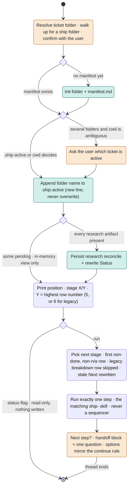
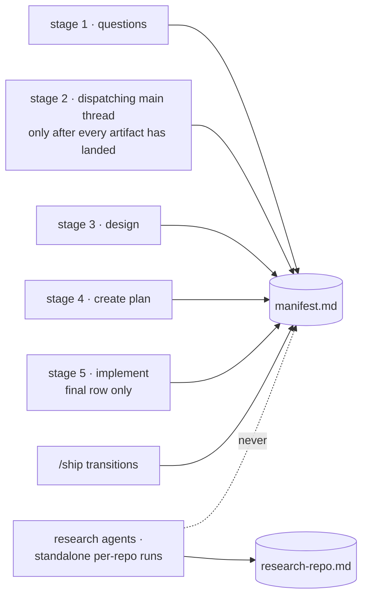

# Ship State Machine

Every `/ship` run is one transition: read the manifest, run exactly one stage, stop. The
manifest on disk is the state; the thread is disposable.

Legend: amber = human input · teal = writes durable state · diamond = machine decision ·
fork/join = parallel agents · red dashed = thread boundary (forced stop).

## One `/ship` invocation



## The five stages

```mermaid
stateDiagram-v2
    direction TB

    classDef human fill:#fbe9d3,stroke:#b5651d,color:#1b2330
    classDef persist fill:#d3efe9,stroke:#0f766e,color:#1b2330
    classDef boundary fill:#ffffff,stroke:#9f2f2f,stroke-dasharray:2 4,color:#9f2f2f

    state "/ship · first non-done, non-n/a row in the Stages table" as Dispatch
    [*] --> Dispatch
    Dispatch --> Questions : fresh manifest

    state "Stage 1 · Questions · /ship-generate-questions · sees the ticket" as Questions {
        direction LR
        q1 : Read ticket (fetch Jira when an ID is given)
        q2 : Confirm repo scope · multi-select over every candidate
        q3 : Write research-questions-repo.md · intent-neutral
        q4 : Seed manifest · Repo Scope · Stages rows 1-5 · Next
        q5 : Review questions · add, remove, refine
        [*] --> q1
        q1 --> q2
        q2 --> q3
        q3 --> q4
        q4 --> q5
        q5 --> [*]
    }

    state next1 <<choice>>
    Questions --> next1 : Next step?
    next1 --> Research : continue in this thread
    next1 --> [*] : stop · handoff block · resume with /ship

    state "Stage 2 · Research · /ship-research-codebase · never sees the ticket" as Research {
        direction LR
        r1 : Read questions per confirmed repo
        rA : Agent for repo A writes research-A.md (artifact only)
        rB : Agent for repo B writes research-B.md (artifact only)
        r2 : Persist reconcile + Next (manifest, dispatching main thread only)
        state fork_r <<fork>>
        state join_r <<join>>
        state r_all <<choice>>
        [*] --> r1
        r1 --> fork_r : one agent per repo
        fork_r --> rA
        fork_r --> rB
        rA --> join_r
        rB --> join_r
        join_r --> r_all
        r_all --> r2 : all research present
        r_all --> [*] : some missing · in-memory view only
        r2 --> [*]
    }

    state "THREAD BOUNDARY · Next step? start a FRESH thread · Next /ship-solution-design" as TB2
    Research --> TB2
    TB2 --> Design

    state "Stage 3 · Solution design · /ship-solution-design · output contract is the coverage map" as Design {
        direction LR
        d1 : Read research + ticket · persist research reconcile
        d2 : Extract 3-5 real patterns with file and line
        d3 : Question walk · one at a time · written to design-questions.md before asking
        d4 : Write design.md · every dimension covered or N/A
        d5 : Review depth? Full · Combined · Skip
        dl1 : ship-antagonistic-review · lens 1
        dln : ship-antagonistic-review · lens n
        d6 : Incorporate valid findings
        d7 : Log reviews + Next /ship-create-plan (manifest)
        state d_aligned <<choice>>
        state fork_d <<fork>>
        state join_d <<join>>
        [*] --> d1
        d1 --> d2
        d2 --> d3
        d3 --> d3 : answer settled · a reversal re-walks the branch
        d3 --> d_aligned
        d_aligned --> d3 : continue
        d_aligned --> d4 : aligned · all dims · 8+ questions · 3 recs taken in a row
        d4 --> d5
        d5 --> fork_d : Full or Combined
        d5 --> d7 : Skip (reason logged)
        fork_d --> dl1
        fork_d --> dln
        dl1 --> join_d
        dln --> join_d
        join_d --> d6
        d6 --> d7
        d7 --> [*]
    }

    state next3 <<choice>>
    Design --> next3 : Next step?
    next3 --> Plan : continue in this thread (context under ~130k)
    next3 --> [*] : stop · handoff block · resume with /ship

    state "Stage 4 · Create plan · /ship-create-plan · delivery shape first, then file-level tasks" as Plan {
        direction LR
        p1 : Read design + research (+ legacy work-breakdown.md as context)
        p2 : Decide delivery shape · milestone · slices · PRs · releases · order
        p2b : Ask the user (only a genuinely open shape question)
        pa : Sub-agent per phase · files · patterns · tests · conventions
        pb : Sub-agent per phase
        p3 : Write plan.md · Delivery Shape section + file-level phases
        p4 : ship-antagonistic-review · LENS design · shape and tasks
        p5 : Incorporate valid findings
        p6 : Mark Create plan done · legacy row n/a · Next /ship-implement-plan (manifest)
        state p_open <<choice>>
        state fork_p <<fork>>
        state join_p <<join>>
        state p_fits <<choice>>
        [*] --> p1
        p1 --> p2
        p2 --> p_open
        p_open --> p2b : shape genuinely open
        p_open --> fork_p : decided · no approval pause
        p2b --> fork_p
        fork_p --> pa
        fork_p --> pb
        pa --> join_p
        pb --> join_p
        join_p --> p_fits
        p_fits --> p2 : a phase exceeds one session · thinner slice, else sub-phases
        p_fits --> p3 : every phase fits one session
        p3 --> p4
        p4 --> p5
        p5 --> p6
        p6 --> [*]
    }

    state "THREAD BOUNDARY · Next step? start a FRESH thread · Next /ship-implement-plan" as TB4
    Plan --> TB4
    TB4 --> Implement

    state "Stage 5 · Implement plan · /ship-implement-plan · terminal" as Implement {
        direction LR
        state "For each phase, in plan order · resume from the first unchecked item" as Phase {
            direction LR
            i1 : Read phase files before any change
            i2 : Smallest change that works · tests for logic worth testing · design patterns only
            i2b : Mismatch · stop and surface · adapt the phase or revisit upstream
            i3 : Automated verification · tests · types · lint
            i4 : git commit + tick plan.md checkboxes (plan.md never committed)
            i5 : Manual check · Ready or Issues
            state i_match <<choice>>
            [*] --> i1
            i1 --> i2
            i2 --> i_match
            i_match --> i2b : code differs from plan
            i_match --> i3 : matches
            i3 --> i4
            i4 --> i5
            i5 --> [*] : Ready
        }
        i7 : Review · comment audit subagent + ship-antagonistic-review on the diff · commit
        i6 : Mark Implement plan done (the only manifest write here)
        [*] --> Phase
        Phase --> Phase : next phase
        Phase --> i7 : all phases done
        i7 --> i6
        i6 --> [*]
    }
    Implement --> [*] : pipeline complete

    class q2,q5,d3,d5,p2b,i2b,i5 human
    class q3,q4,rA,rB,r2,d1,d4,d7,p3,p6,i4,i6 persist
    class TB2,TB4 boundary
```



Two kinds of stop. After questions and after design the user may continue in the same thread.
After research and after create plan the thread must end, so the next stage starts with a clean
context. Every stop prints the handoff block and asks one question whose options mirror the rule.

## Persistent state

```text
# workspace root
.ship-active                 one folder name per line; dispatcher appends, never overwrites
<TICKET>-ship/
  manifest.md                THE state. Sections:
    ## Status                Current stage · Next (exact command, fresh thread)
    ## Repo Scope            workspace root · every candidate repo, selected or dropped
    ## Stages                | # | Stage | Status | Artifact |   pending · in-progress · done · n/a
    ## Artifacts & Reviews   per artifact: Authored + Review [type]: outcome lines
  research-questions-<repo>.md   stage 1
  research-<repo>.md             stage 2  (agents write these, never the manifest)
  design.md                      stage 3
  design-questions.md            stage 3  (written before each question is asked)
  plan.md                        stage 4  (stage 5 ticks its checkboxes)
  work-breakdown.md              legacy runs only; read as context
  .research-parts/               transient fragments, deleted after synthesis

# the code repos
git commits, one per phase    stage 5  (plan.md itself is never committed)
```

Who may write `manifest.md` (single-writer rule):



- **Derived, not stored.** Research rows are reconciled from artifact presence on every read.
  While any repo is still pending, the reconciled view exists only in memory so parallel
  terminals never race the file.
- **Never persisted.** Which thread you are in, how much context it has used, and the offer to
  continue. Each thread rebuilds its picture from the folder.
- **Resume from anywhere.** `/ship` in a new thread reads the table, skips finished rows, and
  runs the first unfinished one.

## Interaction and decision points by stage

| Stage | Human input | Machine decisions | After it completes |
|---|---|---|---|
| 1 Questions | Confirm folder · confirm repo scope and workspace root · review questions | Single-repo degrade when no sibling repos · which candidates to shortlist | Offer to run research in this thread |
| 2 Research | None during the run · Next step at the stop | Parallel vs in-thread by pending repo count · one agent per repo unless subsystems are disjoint · persist only when every artifact exists | Forced stop, fresh thread for design |
| 3 Solution design | Answer each question (or the team fills the file asynchronously) · stop or continue when aligned · review depth Full / Combined / Skip | Explore the codebase instead of asking when possible · stop condition · which lenses are relevant · which findings to incorporate | Offer to continue to create plan in this thread if context allows |
| 4 Create plan | Only if the design leaves a shape question open · Next step at the stop | Delivery shape: milestone, slices, PR grouping, release boundaries, order · split any phase that exceeds one session · which review findings to incorporate | Forced stop, fresh thread for implementation |
| 5 Implement plan | Manual verification after each phase · choose adapt vs revisit on a mismatch | Resume point from checkboxes · does the code match the plan · run phases consecutively only if told to | Pipeline complete, no question asked |

## Legacy six-stage manifests

- A ticket started before the merge has a row `4 | Work breakdown` (or `Structure outline`) and
  prints as `X/6`. Rows are never renumbered.
- If that row is `done`, it stays and create plan reads its file as context. Any other status is
  treated as `n/a` when picking the next stage, and create plan writes `n/a · merged into Create
  plan` on it.
- A stale `Next: /ship-work-breakdown` means `/ship-create-plan`.
